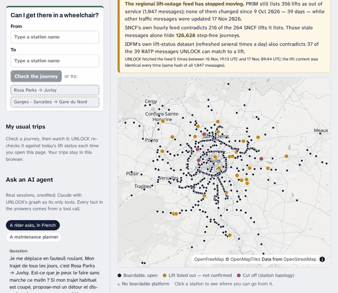
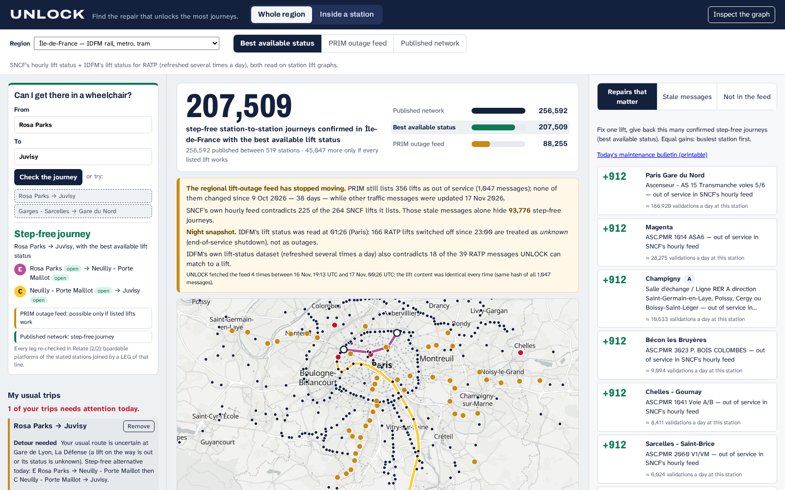
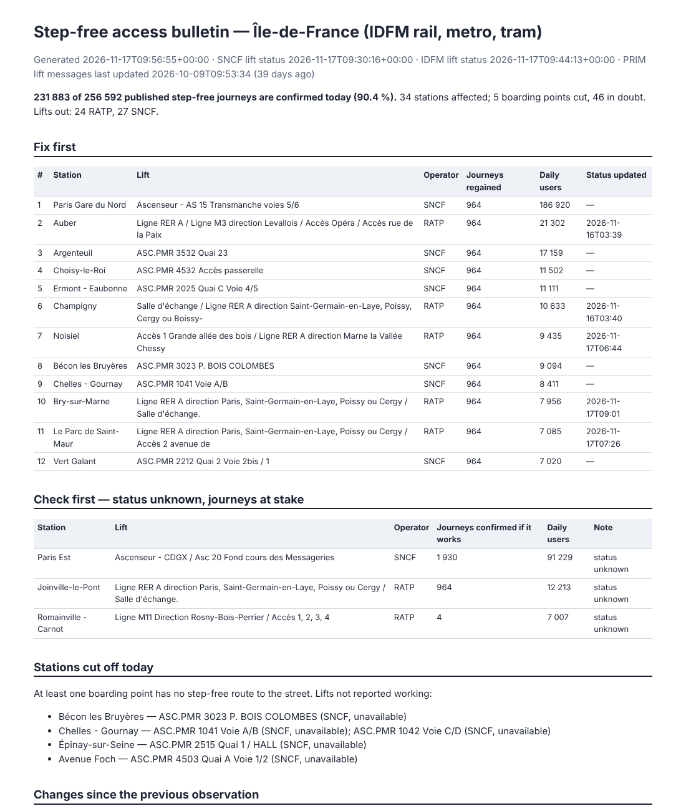
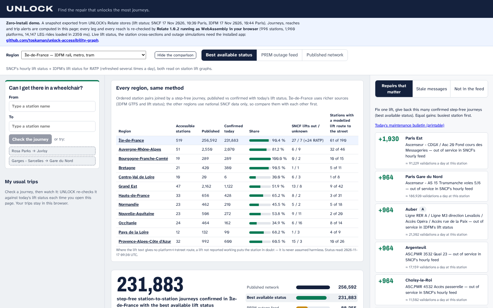

# UNLOCK — The Accessibility Impact Graph

**Find the repair that unlocks the most journeys.**

UNLOCK puts the whole Île-de-France rail, metro and tram network — 996 stations, 60 lines, every platform the
publishers declare wheelchair-boardable — into a [Relate](https://github.com/relatedb/relate) graph, together with
the lift-by-lift structure of the 401 SNCF stations and the lift outages that are actually published. It answers,
for the whole region and down to a single underpass:

* **Which step-free journeys exist right now, and which lift outages cut them?**
* **Where can I go from here in a wheelchair?** — click a station: the whole map shows what is reachable step-free.
* **Can I get from A to B in a wheelchair?** — with the route, and the outages on the way.
* **Which repair gives the most back?** — region-wide, then lift by lift inside a station.
* **Is the outage data even right?** — UNLOCK cross-checks the regional outage feed against the operators' own.
* **Is my usual trip still step-free today?** — watch a trip; UNLOCK re-checks it against today's lift status and
  proposes a step-free detour ([rider alerts](docs/RIDER_ALERTS.md)).
* **What should the lift teams do this morning?** — a one-page [daily bulletin](docs/BULLETIN.md) generated from
  the graph.
* **Does it work elsewhere?** — the same code runs on **every region of mainland France** from national SNCF open
  data, with a side-by-side comparison ([regions](docs/REGIONS.md)).
* **How long do outages last, which lifts are always out?** — UNLOCK records the lift status twice a day, lists the
  lifts that are out again and again, and replays the region on the map, observation by observation
  ([history](docs/HISTORY.md)).
* **Can an AI agent answer a rider truthfully?** — yes, from the graph: see a real, unedited
  [agent transcript](docs/AGENT_DEMO.md) (« mon trajet Rosa Parks → Juvisy est-il possible ce matin ? »), also
  replayed in the demo (*Ask an AI agent*).
* **Can agents share what they see?** — yes: one agent (or rider) writes a **field report** into the Relate graph,
  another agent in a new session reads it back and sets it against the official status — without ever changing it
  ([two agents, one memory](docs/AGENT_DEMO.md#two-agents-one-memory)).

Every number on screen is computed on the graph and can be traced back to a source record.

> **What the data showed on 24 Nov 2026.** The PRIM traffic-information API lists **356 lifts out of service**
> (1,045 messages) — and **none of those messages has changed since 9 October 2026 (46 days)**, while every other traffic
> message is updated the same day: 22 fetches since 16 Nov, lift content identical in the last 13. On 24 Nov at
> 20:05 Paris, SNCF's own hourly lift feed reports **228 of the 264 SNCF lifts it lists as working** (160 read into
> the exact lift, 68 at stations where every lift reports working), and IDFM's own
> lift-status dataset contradicts **38 of the 39 RATP messages** UNLOCK can match to a lift. Those stale messages alone
> hide **130,358** step-free journeys from anyone who builds on the feed.
> Method and figures: [docs/research/NETWORK_DISCOVERY.md](docs/research/NETWORK_DISCOVERY.md).

**▶ Try it now, nothing to install: https://toskaman.github.io/unlock-accessibility-graph/** (in English or
French: switch in the header, or [open it in French](https://toskaman.github.io/unlock-accessibility-graph/?lang=fr)).
Rebuilt every hour from the live lift status by GitHub Actions ([how](docs/LIVE_DEMO.md)) — every region of
mainland France, journeys, reach, trip alerts and the bulletin, on a snapshot exported from the Relate stores; every
journey leg and every reach is re-checked by **Relate itself, compiled to WebAssembly, in your browser**. (Live
status, station cross-sections and simulations need the installed app below.)

**▶ Demo video:** v0.2.0 (station mode, 1 min 36 s): [unlock-demo.mp4](https://github.com/toskaman/unlock-accessibility-graph/releases/download/v0.2.0/unlock-demo.mp4).
The region mode (v0.6.0) is shown in the screenshots below.



> Built for the *Relate by Neo4j Hackathon 2026*. This is a decision-support prototype built from public
> data. It has not been validated by any operator for operational use.

## The problem

A platform can be "accessible" and still be unreachable if one lift fails. Whether that matters depends
on what else that lift connects, whether another route exists — inside the station and across the network —
and on whether the outage is even real. That information is scattered:

- **Network and boardable platforms** are in GTFS and an IDFM accessibility table.
- **Station structure** is in a NeTEx file; **lift locations** are free text ("Voies 50 et 51 / souterrain nord").
- **Lift status** comes from two feeds that disagree: SNCF's hourly file and the PRIM traffic messages (RATP + SNCF).

UNLOCK connects these sources so you can ask: *"Which repair restores the most verified step-free journeys?"*

## Ways in

| You have… | Do this | You get |
|---|---|---|
| **A trip you make every day** | *Whole region* → check it → *Watch* (or `python -m unlock alerts trips.json`, or the API) | Each time: *step-free today* / *detour needed* (with the detour) / *at risk* / *cut*, and the lifts responsible. Trips stay in your browser. |
| **Lift teams to brief** | *Repairs that matter* → *Today's maintenance bulletin*, or `python -m unlock bulletin` | A printable page: repairs ranked by journeys given back (ties: busiest station), stations cut off and their lifts, changes since the last fetch, statuses to check, messages to correct. |
| **Another region** | `python -m unlock build-region all`, then the region picker / *Compare all regions* | The same views, journeys, alerts and bulletin for the 11 other regions of mainland France, and one comparison table. |
| **A trip to make** | *Whole region* → *Can I get there in a wheelchair?* | The least-cost step-free route under each view (best available status / PRIM feed / published network), each leg re-checked in Relate, and the outages listed on the way. |
| **A region to run** | *Whole region* → *Repairs that matter* | Every listed outage and every SNCF lift out of service, ranked by the step-free journeys its repair gives back across Île-de-France. |
| **Doubts about the data** | *Whole region* → *Stale messages* / *Not in the feed* | PRIM messages SNCF contradicts, ranked by the journeys they hide; SNCF outages PRIM doesn't show. A draft note to IDFM is in `docs/research/PRIM_LIFT_FEED_NOTE.md`. |
| **An outage report** in free text (“Juvisy : ascenseur quai 50/51 HS”) | *Inside a station* → *Start from an outage report* | The exact lift in the graph with the evidence that matched, then one click to simulate its outage. Ambiguous reports are **not guessed**. |
| **A maintenance budget for a station network** | *Inside a station* → *Repairs to make* / *Lifts you can't lose* | Lifts ranked by confirmed in-station connections restored; 213 single points of failure. |
| **Something you see on site** ("the lift on platform 50/51 is out") | Click the station → *Report what you see*, or tell an AI agent | A field report in the shared graph, compared with the official status (confirms / contradicts / new information). It never changes a count; it shows up for every user, every agent and in the bulletin. |
| **A history question** ("which lifts are always out?") | *Whole region* → *History* tab; under the chart, *Replay on the map* | Lifts ranked by share of daytime observations out of service (*chronic* ≥ 30 % over ≥ 7 days), how long each has been out; the map replays the stations cut or in doubt at each observation. |
| **An AI agent** (Claude Code, Claude Desktop…) | `python -m unlock mcp` | The same graph as read-only MCP tools, including `check_journey`, `usual_trip_alert` and `region_overview` — [transcript](docs/AGENT_DEMO.md). |

## Whole region in one minute

Figures below: daytime snapshot of **24 Nov 2026, 19:30–20:05 Paris** (the app recomputes them from whatever
snapshot is loaded; `python -m unlock refresh` fetches a new one). Night snapshots are flagged: lifts switched off at
the end of service appear in IDFM's dataset as failures — UNLOCK counts those switched off since 23:00 as *unknown*,
never as outages (166 of them on the night of 16–17 Nov).

1. The app opens on **Whole region**. The headline is the number of ordered station pairs joined by a
   confirmed step-free journey: **256,592** in the published network, **234,781** with the best available lift
   status (SNCF's hourly feed for SNCF lifts, IDFM's lift-status dataset for RATP lifts, both read on station lift
   graphs), **88,255** if you believe the PRIM feed.
2. The amber card explains the gap: PRIM's lift messages have not moved for 46 days; SNCF contradicts 228 of its
   264 SNCF entries and IDFM's own dataset 38 of the 39 RATP entries it can be matched to.
3. *Can I get there in a wheelchair?* — **Rosa Parks → Juvisy**: step-free with the best status (tram T3b, then
   line 14, then RER D); with the PRIM feed only *possible if listed lifts work*. Each leg
   says "re-checked in Relate". *Watch* it: it joins *My usual trips* and is re-checked at every visit.
4. *Repairs that matter*: **Paris Est** first (+1,942 journeys: lift CDGX / Asc 20 Fond cours des Messageries);
   then equal gains (a repair usually gives one station back to the whole network: +970) are ordered by how busy
   the station is — **Charles de Gaulle - Étoile** (RER A, ≈ 57,498 validations a day) before Haussmann
   Saint-Lazare, Paris Austerlitz, Vincennes. *Today's maintenance bulletin* turns the list into a printable page.
5. Click **Rosa Parks** on the map: the whole region recolours — 481 stations reachable step-free from there with the
   best available status on 17 Nov (22 only if listed lifts work, 3 cut), together ≈ 3.1 million validations a day.
   With the PRIM feed: 294. *Re-derived in Relate with Cypher: 481 = 481.*

   

6. The station card lists every lift IDFM's dataset has at the station with its status, then each PRIM message,
   its age, and — for SNCF lifts — the lift UNLOCK matched it to and what SNCF's hourly feed says.
   *Open inside the station* switches to the station cross-section.
7. *Compare all regions*: the same method on national SNCF data for the 11 other regions of mainland France (table
   below). Pick **Auvergne-Rhône-Alpes** and check e.g. *Lyon Gorge de Loup → Lyon Part Dieu*.

## Every region of mainland France

Same code, same day. Île-de-France uses richer sources (IDFM GTFS and lift status); the other regions use national
SNCF data only (timetable, NeTEx stations and lifts, hourly lift status). *Published* = ordered pairs of stations
joined by a step-free route on the published network; *confirmed* = with today's lift status. The last column says
how much of each region's station topology the lift text lets UNLOCK model — where no platform↔street route is
modelled, a lift not reported working puts the station in doubt, never assumed harmless (D31).

| Region | Accessible stations | Published | Confirmed | Share | SNCF lifts out / unknown | Modelled street route |
|---|---|---|---|---|---|---|
| Île-de-France | 519 | 256,592 | 234,781 | 91.5 % | 25 / 7 (+ 18 RATP) | 61 of 190 |
| Auvergne-Rhône-Alpes | 51 | 2,550 | 1,980 | 77.6 % | 7 / 8 | 32 of 46 |
| Bourgogne-Franche-Comté | 19 | 289 | 256 | 88.6 % | 2 / 2 | 10 of 15 |
| Bretagne | 21 | 420 | 380 | 90.5 % | 1 / 1 | 5 of 11 |
| Centre-Val de Loire | 10 | 20 | 8 | 40.0 % | 2 / 3 | 1 of 8 |
| Grand Est | 47 | 2,162 | 1,190 | 55.0 % | 12 / 8 | 9 of 42 |
| Hauts-de-France | 33 | 656 | 442 | 67.4 % | 6 / 2 | 3 of 31 |
| Normandie | 23 | 462 | 84 | 18.2 % | 6 / 2 | 5 of 18 |
| Nouvelle-Aquitaine | 23 | 506 | 272 | 53.8 % | 8 / 12 | 2 of 20 |
| Occitanie | 24 | 464 | 140 | 30.2 % | 8 / 16 | 8 of 14 |
| Pays de la Loire | 13 | 156 | 72 | 46.2 % | 4 / 3 | 5 of 10 |
| Provence-Alpes-Côte d'Azur | 32 | 992 | 650 | 65.5 % | 10 / 3 | 10 of 26 |

*Snapshot: lift status of 24 Nov 2026, 19:30–20:05 Paris (daytime). The app and the comparison recompute from
whatever status is loaded; observations are recorded every 3 hours ([history](docs/HISTORY.md)). At night the same
table looked very different (Bourgogne-Franche-Comté 31 %, Occitanie 13 % on 17 Nov): SNCF's file carries no per-lift time, so
lifts switched off for the night look like outages — refresh in the daytime before quoting figures.*








## Inside a station


1. Open **Juvisy-sur-Orge** (RER C & D, 12 platforms joined by an underpass). The station cross-section
   shows halls and exits, underpasses and footbridges, and platforms, with each lift as a green, red or
   amber square.
2. Select lift **ASC3 (Voies 50 et 51 / souterrain nord)**. UNLOCK says 21 modeled connections can use
   it, and that all 21 would be lost if it stopped.
3. Click **Simulate outage**. Voie 50 and Voie 51 turn red, and 21 connections move from
   *Confirmed step-free* to *Blocked*. The published observations are not modified.
4. The ranking recomputes over every lift that is out of service or unknown in Île-de-France. The
   simulated lift ranks first (+21), ahead of the real out-of-service lifts at Mantes-la-Jolie (+15) and
   Noisy-le-Sec (+15).
5. Click a broken connection to see the evidence:
   - the actual Relate path (`Voie 40 –SERVES– ASC8 –SERVES– souterrain nord –SERVES– ASC3 –SERVES– Voie 50`)
   - how each edge was derived
   - each lift's published status, with snapshot id and time
   - what remains unknown
6. Switch between **Published status**, **Simulated outage** and **With proposed repair** to compare.
   Click **Restore published status**: the counts return to exactly the published-status values.

## How Relate is used (and why a graph)

**Mode: single file**, embedded (`relate-db` Python library) — plus Relate's **WebAssembly** build in the browser for
the zero-install demo. *Why a single file:* the graph is a published, versioned artefact — judges and users open the
exact store the numbers came from, copy it, or inspect it read-only beside the running app; one region = one file
(`database/regions/<code>.rl`), deleted and rebuilt in seconds. In-memory would lose the evidence trail between
runs; a directory store adds nothing for one writer.

**Where the data lives:** `database/unlock.rl` (Île-de-France, created by `python -m unlock build` or on first
`serve`), `database/regions/<code>.rl` (other regions, `build-region`), and a committed, inspectable copy:
`database/snapshot/unlock-snapshot-2026-11-17.rl`. The normalized inputs they are built from are committed in
`data/normalized/` (ODbL / Licence Mobilités, see data/LICENSE-DATA.md).

**What the graph models:** stations, quays, halls and the lifts that join them (`SERVES`, each edge labelled with how
it was derived from the lift text); the rail/metro/tram network (`HAS_PLATFORM`, `NEXT`, `LEG`); lift status from
three publishers with their snapshots and source hashes; outage messages and the lift each one is about; scenarios
and analyses written back next to the facts they used.

| Concern | In Relate |
|---|---|
| Storage | Persistent single-file store `database/unlock.rl`, created and reopened by the app. A clean copy built from the committed snapshot is at `database/snapshot/unlock-snapshot-2026-11-17.rl`. |
| Core question | One Cypher traversal finds every acyclic route between pairs of station spaces: `MATCH p = ACYCLIC (a)-[:SERVES]-{2,10}(b)`. Lifts in series and in parallel fall out of the path set. |
| Evidence | Explanations re-read the exact path (`nodes(p)`, `relationships(p)`) and follow `HAS_STATUS → StatusSnapshot → REPORTED_IN → Dataset(sha256)` and `ABOUT ← AccessibilityAssertion → SUPPORTED_BY`. |
| Cross-check | Every analysis re-counts the affected stations entirely in Cypher, with the scenario overrides passed as a map parameter (`coalesce($ovr[l.id], …)`). The UI shows "engine = Cypher". |
| Scenarios | `(:Scenario)-[:OVERRIDES {state}]->(:Lift)` and `(:Scenario)-[:PRODUCES]->(:AnalysisResult)`. Observations are never modified. |
| Integrity | Uniqueness constraints on every id, idempotent `MERGE` import, transactions, parameterised queries. |
| Limits respected | A file store allows one writer and connections stick to one thread. UNLOCK owns the connection on a single dedicated thread and serialises all queries through it (see `backend/unlock/db.py`). |

| Region network | `(:NStation)-[:HAS_PLATFORM]->(:NPlatform {boardable})-[:LEG {line, hops}]->(:NPlatform)`, `NEXT` stop sequences per GTFS pattern, `(:NStation)-[:IS_ZONE]->(:TransferZone)<-[:IN_TRANSFER_ZONE]-(:Station)` joining the region to the station layer. |
| Outage feed | Immutable `(:OutageFeed)-[:LISTS]->(:LiftOutage)`, `-[:AFFECTS {derivation}]->(:NPlatform)`, `-[:MATCHES_LIFT]->(:Lift)` written by the resolver. |
| Region cross-check | Every reach is re-derived in Cypher by breadth-first rounds over `HAS_PLATFORM`/`LEG`; `scripts/region_crosscheck.py` does all 519 origins × 3 views — all ordered pairs agree with the engine ([region_crosscheck.json](docs/research/region_crosscheck.json)). |
| Lift status (RATP) | `(:LiftStatusFeed)-[:LISTS]->(:IdfmLift)-[:CONNECTS {derivation}]->(:NPlatform)`, `-[:SAME_LIFT]->(:Lift)`, `(:LiftOutage)-[:REPORTS_ON]->(:IdfmLift)`; `(:LiftStatusObservation)` per fetch. |
| Regions | One single-file store per region (`database/regions/<code>.rl`, same labels, a `(:Region)` node), opened read-only side by side by the server. |
| In the browser | The zero-install demo loads the region graph exported from the store into **Relate compiled to WebAssembly** (`@relate/relate-wasm`, in-memory, in a worker) and re-runs the server's own Cypher: the reach rounds and the leg check. |
| Region verification | Every journey leg is re-matched in Cypher (`(s1)-[:HAS_PLATFORM]->(x {boardable:true})-[:LEG {line}]->(y)<-[:HAS_PLATFORM]-(s2)`); leg geometry is read back from the `NEXT` chain. |

**Inspect the graph** (top right of the app) shows node and relationship counts, source hashes, the
route query and the last Cypher statements Relate actually executed, with timings.

*Why not a spreadsheet?* A list of lifts with OK/KO tells you a lift is broken, not what it breaks.
Juvisy's Voie 40 ↔ Voie 50 connection needs **two** lifts in series, and other pairs have alternative
routes. Only a path query over the connected structure gives the right answer. The ranking also flags
lifts that pay off only when repaired together.

## What the engine calculates

**Region.** A *journey* is an ordered pair of stations joined by a step-free route: board and alight only at
boardable platforms, change lines only between two boardable platforms of the same station. Platforms are
OPEN, DOUBT (a listed outage concerns it and nothing tells whether another lift serves it) or CLOSED (UNLOCK's
station topology shows no platform keeps a confirmed route to the street). *Confirmed* journeys use OPEN
platforms only; *possible* ones may use DOUBT. Reachability of all ~270,000 ordered pairs is exact (strongly
connected components + bitsets, ~10 ms), so every candidate repair is evaluated by recomputing it.

**Inside a station.** The metric is **confirmed step-free origin–destination pairs**: platform ↔ platform and
platform ↔ exit inside a station. These are modeled connections, **not people**.

Each pair is classified as one of:

- `CONFIRMED_ACCESSIBLE`
- `CONFIRMED_BLOCKED`
- `UNVERIFIED`
- `OUT_OF_SCOPE`

Two dimensions stay separate: the platform's physical step-free assessment, and each lift's
operational status. *Unknown* is never treated as working.

A repair's gain is `confirmed(S + lift fixed) − confirmed(S)` over the same pairs and snapshot. There is
also an exact best set of *k* repairs (`/api/baseline/plan?budget=k`).

Full rules are in **[docs/METHODOLOGY.md](docs/METHODOLOGY.md)**.

## Data

All sources are listed in [DATA_SOURCES.md](DATA_SOURCES.md), with what was checked about them in
[docs/research/DATA_FEASIBILITY.md](docs/research/DATA_FEASIBILITY.md).

| Source | Publisher | Licence | Used for |
|---|---|---|---|
| Accessibilité des gares (NeTEx) | SNCF Gares & Connexions | ODbL 1.0 | stations, platforms, step-free assessments, lifts, lift location text |
| État de fonctionnement des équipements d'élévatique | SNCF Gares & Connexions | ODbL 1.0 | latest published lift status (OK / KO / INCONNU, refreshed hourly) |
| Référentiel des arrêts : Zones de correspondance | Île-de-France Mobilités | Licence Ouverte 2.0 | transfer-zone anchoring |
| GTFS IDFM | Île-de-France Mobilités | Licence Mobilités | rail / metro / tram lines, platforms, `wheelchair_boarding`, stopping patterns |
| Validations sur le réseau ferré (Q2 2026) | Île-de-France Mobilités | Licence Ouverte 2.0 | average daily validations per station — a weight, shown as context |
| Accessibilité en gare | Île-de-France Mobilités | Licence Ouverte 2.0 | rail station accessibility level (autonomous / on request / booked AssistenGare / not accessible) |
| Messages Info Trafic (PRIM API, tag « Ascenseur ») | Île-de-France Mobilités | Licence Mobilités | lift outages for RATP and SNCF stations — **needs a free personal PRIM token** to refresh; a snapshot is committed |
| État des ascenseurs | Île-de-France Mobilités | Licence Mobilités | status of every RATP and SNCF lift in IDF and the levels it joins — **needs a free Opendatasoft API key** to refresh; a snapshot is committed |
| Horaires SNCF (GTFS TER, Intercités, TGV) | SNCF Voyageurs | ODbL 1.0 | second-region network (Auvergne-Rhône-Alpes) |
| Fréquentation en gares (2025) | SNCF Gares & Connexions | ODbL 1.0 | second-region usage weight |

**Important findings from the data check:**

- RATP lift status now comes from IDFM's `etat-des-ascenseurs` dataset (refreshed several times a day; 391 RATP
  lifts, each with the access and platform it joins, read into a per-station lift graph). The PRIM messages are
  kept for comparison only.
- The IDFM GTFS has no elevator pathways, so lift-to-platform links come from the publisher's location
  text. Every such edge is labelled with how it was derived.
- 804 of the 1,662 pairs (48%) have a modeled lift route. The rest are reported as *No modeled route*,
  not as inaccessible.

The derived dataset (`data/normalized/graph_input.json` and the snapshot store) is published under the
ODbL. See [data/LICENSE-DATA.md](data/LICENSE-DATA.md).

## For AI agents: UNLOCK over MCP

The hackathon theme is *connected context makes agents more reliable*. UNLOCK exposes its graph to any MCP agent
through a **read-only** Relate connection (the agent can't modify anything, even through `cypher_read`):

| Tool | What the agent gets |
|---|---|
| `find_lift(report)` | Free-text report → lift id, with the graph evidence, or AMBIGUOUS + candidates |
| `simulate_outage(lift_ids)` | Connections lost/gained, examples, Cypher cross-check, ranking afterwards (nothing persisted) |
| `rank_repairs`, `plan_repairs(budget)` | Repair priorities and the exact best set of *k* repairs |
| `critical_lifts` | Single points of failure |
| `explain_connection(pair_id)` | The actual Relate path, statuses, snapshot, derivations, unknowns |
| `station_overview`, `network_summary`, `cypher_read(query)` | Context and read-only Cypher (row-capped) |
| `step_free_reach(from, view)` | Region: stations reachable step-free from one station, with Cypher re-derivation |
| `check_journey(from, to, view)` | Region: step-free verdict, legs, outages on the way, Relate re-check of every leg |
| `region_overview`, `region_repairs`, `station_outages` | Region views, feed freshness, PRIM-vs-SNCF/IDFM reconciliation, repairs and feed corrections, every lift's status at a station |
| `usual_trip_alert(from, to)` | Rider alert: OK / DETOUR (with the detour) / AT_RISK / CUT, and the lifts responsible |
| `maintenance_bulletin()` | Today's bulletin (Markdown) |
| `report_lift(lift_id, status, note)` | Writes a field report into the shared graph (through the server, Relate's single writer); never changes the official status |
| `field_reports(station, hours)` | Reads back what riders, staff and other agents reported, each against the official status (and IDFM's, when the two official sources differ) |

### Ask an agent — a real transcript

Recorded 17 Nov 2026 with Claude Code in headless mode, whose **only** tools were UNLOCK's MCP tools, on a read-only
copy of the store loaded with that morning's lift status ([full transcript, both questions](docs/AGENT_DEMO.md);
raw JSON in `docs/research/agent_demo/`; reproduce with `python scripts/agent_demo.py`).

> **Rider:** *Je me déplace en fauteuil roulant. Mon trajet de tous les jours, c'est Rosa Parks → Juvisy. Est-ce que
> je peux le faire sans marche ce matin ? Si mon trajet habituel est coupé, propose-moi un détour et dis-moi quel
> ascenseur pose problème.*
>
> **Tool call:** `usual_trip_alert("Rosa Parks", "Juvisy")` → `status: DETOUR`, blocked at Gare de Lyon (RER A,
> alighting), three lifts listed, lift status read at 09:30 UTC (SNCF) and 09:44 UTC (IDFM).
>
> **Agent:** Ton trajet habituel est incertain ce matin : à Gare de Lyon (RER A), des ascenseurs sont en panne ou
> inconnus. Le plus clair : « Ligne RER A – Ligne M14 » (RATP) est en panne. « Quai N / Salle d'échange (5012) » est
> aussi en panne, et « Rue de Bercy (5005) » a un état inconnu. Détour sans marche : RER E de Rosa Parks à
> Neuilly – Porte Maillot, puis RER C de Neuilly – Porte Maillot à Juvisy. Les données datent de 9h30 (SNCF) et 9h44
> (IDFM) ; vérifie sur place avant de partir.

Every station, line, lift and time in that answer is in the tool's output; the agent added nothing. (Its first call
omitted the arguments and was rejected by the tool's schema; the transcript keeps it.) The second question, from a
lift-maintenance planner, gets the top repair (+1,930 journeys), the reason not to plan from the PRIM feed (39 days
unchanged) and the figures of the three views, all from two tool calls.

### Two agents, one memory

Relate is the shared memory. Agent 1, asked by a wheelchair user, resolves « l'ascenseur du quai des voies 50/51 à
Juvisy » to one lift with `find_lift` and stores a field report with `report_lift`. Agent 2 — a new session, for the
maintenance team — calls `field_reports` and answers: the report contradicts SNCF's hourly status (*available*),
IDFM's dataset says *out of service* since the day before, so **check Juvisy ASC3 first**. Neither agent invented a
fact; the report changed no journey count. Full transcript: [docs/AGENT_DEMO.md](docs/AGENT_DEMO.md#two-agents-one-memory).

### Set it up

```bash
pip install -e ".[agent]"
claude mcp add unlock -- python -m unlock mcp   # Claude Code (uses database/unlock.rl); other MCP clients alike
# field reports: start `python -m unlock serve`, then give the MCP server UNLOCK_API_URL=http://127.0.0.1:8000
# another region: python -m unlock mcp --store database/regions/ara.rl
```

**A real agent, with and without the graph.** Claude Code (model `claude-sonnet-5-5`) answered eight planner and
rider questions (five station-level, three region-level). With the UNLOCK MCP tools: **7/8 correct**, every number
taken from a tool (the miss gave the right count but only one of two causes). Without them: **0/8** — the model
declined to answer each time. The region round exposed two tool-output gaps that were fixed and re-run; both rounds
are published. Details and transcripts: [docs/research/AGENT_EVAL.md](docs/research/AGENT_EVAL.md).

**Why the graph matters for the agent — measured.** On 22 hand-written outage reports
(`data/eval/incidents.jsonl`, synthetic, developer-labelled), the graph-grounded resolver identifies the right
lift or correctly refuses to guess in **21/22** cases with **0** confidently wrong answers. A text search over the
same source records (lift names and descriptions, no graph) gets **9/22** and is **confidently wrong 13 times**.
Run `python scripts/eval_incidents.py`; results in `docs/research/incident_eval.json`. The resolver was tuned on
this set; there is no held-out set yet.

## Run it

You need Python ≥ 3.10. Node ≥ 20 is only needed to rebuild the UI. Tested natively on **Windows 10
(Python 3.14.4)**, on Linux with Python 3.13, and on a Linux VM with Python 3.10 — the full test suite passes
on all three. See the [Windows notes](#windows).

```bash
git clone https://github.com/toskaman/unlock-accessibility-graph.git unlock && cd unlock
python -m venv .venv && source .venv/bin/activate      # Windows: .venv\Scripts\activate
pip install -e ".[dev]"                                # installs relate-db==1.0.2, fastapi, uvicorn

python -m unlock build      # import the committed snapshots (station layer + region network + outage feed) (~5 s)
python -m unlock serve      # http://127.0.0.1:8000  (API + prebuilt UI)
```

`serve` builds the store automatically if `database/unlock.rl` is missing. The UI is served from
`frontend/dist`. To rebuild it:

```bash
cd frontend && npm ci && npm run build      # or: npm run dev (Vite on :5173, proxies /api)
```

**Refresh from the official sources** (downloads about 130 MB, mostly GTFS):

```bash
python -m unlock fetch      # data/raw + data/manifest/sources.json (sha256, timestamps)
python -m unlock build      # re-normalise and import. Idempotent; status history is kept.
```

**Refresh the lift outages** (needs a free PRIM account token; it is read from the environment and never written
to disk by UNLOCK):

```bash
export UNLOCK_PRIM_KEY_FILE=/path/outside/the/repo/prim.key   # or UNLOCK_PRIM_KEY=...
python -m unlock fetch-outages    # data/raw/prim/line_reports.json -> data/normalized/network_outages.json
python -m unlock build
```

**Refresh the RATP lift status** (needs a free Opendatasoft key from data.iledefrance-mobilites.fr → account →
API keys; read from the environment only):

```bash
export UNLOCK_IDFM_ODS_KEY_FILE=/path/outside/the/repo/ods.key   # or UNLOCK_IDFM_ODS_KEY=...
python -m unlock fetch-lifts      # + one observation in data/normalized/idfm_lift_history.json
python -m unlock refresh          # or everything at once: SNCF + PRIM + IDFM status, then rebuild every region
```

**Second region, rider alerts, bulletin**

```bash
python -m unlock build-region all           # every mainland region from national SNCF data (~1 min); served by `serve`
python -m unlock record                     # append the lift-status history + headline metrics of every region
python scripts/export_static.py && (cd frontend && node scripts/build-static.mjs)   # zero-install demo → site/
python -m unlock alerts trips.json          # {"trips": [{"from": "Rosa Parks", "to": "Juvisy"}]} — exit 1 if a trip is not OK
python -m unlock bulletin                   # reports/bulletin-<date>.{json,md,html}
```

**Inspect the store directly** with Relate's own Python API:

```python
import relate
db = relate.connect("database/snapshot/unlock-snapshot-2026-11-17.rl", read_only=True)
db.execute("""MATCH (s:Station {name: 'Juvisy-sur-Orge'})-[:HAS_LIFT]->(l:Lift)-[e:SERVES]->(sp:Space)
              RETURN l.name, e.derivation, sp.name ORDER BY l.name""").fetchall()
```

### Windows

```powershell
py -3.12 -m venv .venv; .venv\Scripts\Activate.ps1
pip install -e ".[dev]"
python -m unlock build; python -m unlock serve
```

The store is one `.rl` file. Only one process can open it for writing at a time, so stop the server
before re-importing. If the project sits on a network drive, create the virtual environment on a local
disk (e.g. `py -3 -m venv D:\venvs\unlock`): pip upgrades inside a venv on an SMB share can fail.

## Tests

```bash
pytest                              # 112 tests: unit, real-Relate integration, API, region, alerts, bulletin, second region, agent/MCP, data quality, département recovery, snapshot validation
cd frontend && npx playwright test  # 14 end-to-end tests, incl. the EN/FR switch, a field report, the agent replay, the map as a list, an axe-core WCAG 2.1 AA scan (0 serious/critical) and the rider-alert flow, on a copy of the store
python scripts/benchmark.py         # writes docs/BENCHMARK.json
node frontend/scripts/check-static-a11y.mjs [url]   # axe-core WCAG 2.0/2.1 A+AA on the zero-install demo, desktop and phone (iPhone 13), home and journey+history views
```

**Accessibility and phones.** The app is built for the people it is about: station states shown by shape as well as
colour (dot / ring / cross), the whole map also available as a list, an easy-read (FALC) version of the main message,
text never below 14 px, 44 px touch targets on phones, dark mode from the system setting, visible focus,
reduced-motion respected, Atkinson Hyperlegible type. The deployed demo is scanned with axe-core (all WCAG 2.0
and 2.1 A/AA rules) on a desktop and a phone viewport: see *Results* in [CHANGELOG](CHANGELOG.md) for the latest run.
On a phone the layout becomes one column with no horizontal scrolling.

The integration tests use the real Relate engine with file-backed stores. They cover:

- persistence across reopen, idempotent import, uniqueness constraints, rollback and backup/restore
- refusal of a second writer
- parameter safety
- alternative routes, and unknown vs. unavailable lift status
- non-destructive and reversible scenarios
- deterministic analysis ids, and use of a single status snapshot

See [TEST_PLAN.md](TEST_PLAN.md).

Measured on the pilot (2-vCPU Linux container, median of 20 runs; full table in
[docs/BENCHMARK.json](docs/BENCHMARK.json)):

| Operation | Time |
|---|---|
| Fresh import (station layer + region network + outage feed + resolver matching) | 4.7 s |
| Service start, including the station route traversal and the resolver index | 4.5 s |
| Region layer start (network, outages, station topology per zone) | 0.17 s |
| Exact reachability of every ordered station pair | 10 ms |
| Three region views, first call | 105 ms |
| Rank every region repair and feed correction (107 evaluations) | 1.4 s |
| Journey check incl. Relate re-check of every leg and geometry | 39 ms |
| Reach from one station + Cypher re-derivation (5–6 BFS rounds) | ~0.4 s |
| Single-station traversal | 11 ms |
| Create, analyse and persist a scenario (incl. Cypher cross-check) | 15 ms |
| Rank every candidate repair in the region | 6 ms |
| Explain a pair with evidence | 4 ms |
| Critical-lift scan of all 304 working lifts on modeled routes | 13 ms |

## API

Main endpoints:

- `GET /api/network/summary`
- `GET /api/network/stations`
- `GET /api/network/stations/{id}?scenario_id=&candidate_lift=`
- `GET /api/network/lifts/{id}`
- `POST /api/scenarios/simulate-outage {"lift_ids": [...]}`
- `GET /api/scenarios/{id}/analysis`
- `POST /api/scenarios/{id}/rank-interventions`
- `GET /api/scenarios/{id}/plan?budget=2`
- `GET /api/pairs/explain?pair_id=&scenario_id=&candidate_lift=`
- `POST /api/scenarios/{id}/export`
- `DELETE /api/scenarios/{id}`
- `GET /api/debug/queries`
- `GET /api/region/overview` · `GET /api/region/map?view=best|feed|published` · `GET /api/region/rank`
- `GET /api/region/reach?from=&view=` · `GET /api/region/journey?from=&to=&view=` · `GET /api/region/stations?q=` · `GET /api/region/reconciliation`
- `GET /api/region/stations/{id}/outages` (PRIM messages + every lift in IDFM's status) · `GET /api/region/outages/{id}`
- `POST /api/region/trips/check {"trips": [{"from", "to", "usual"?, "last_status"?}]}` — rider alerts (stateless)
- `GET /api/region/bulletin` · `GET /api/region/bulletin.html` — daily bulletin
- `GET /api/region/trips/feed.rss|feed.ics?from=&to=` — subscribe to a trip (stateless)
- `GET /api/region/history` — recorded headline numbers · `GET /api/regions/compare` — all regions side by side
- `GET /api/regions` — every `/api/region/*` call takes `?region=<code>` (ara, bfc, bre, cvl, ges, hdf, nor, naq, occ, pdl, pac)

OpenAPI docs are at `/docs`. No endpoint accepts Cypher.

## Known limitations

- Lift endpoints are derived from text. Ramps and level access are not in the source, so *Blocked*
  means "no modeled step-free route". 42% of lifts describe only one end, and those ends never connect
  to anything.
- The lift-by-lift station layer covers SNCF-managed stations (NeTEx). RATP stations get a lighter lift graph from
  IDFM's dataset (access ↔ hall ↔ platform per lift); a platform no RATP lift lists is not modelled.
- Lift status at night: IDFM's dataset reports lifts switched off at end of service as failures. UNLOCK treats
  those switched off since 23:00 in a night snapshot as *unknown*. SNCF's hourly file has no per-lift time, so a
  night SNCF snapshot may still include such switch-offs — refresh during the day for daytime figures.
- Outside Île-de-France, boardability comes from the station-level NeTEx flag (the national GTFS has none), there is
  no second status source, and many stations have no exit named in the lift text (their lifts can only make them
  *doubtful*). The comparison table shows how much is modelled per region.
- The zero-install demo is a snapshot: no live status, no station cross-sections, no simulations, no subscriptions.
- Region journeys are ordered station pairs, not trips or people; RER/Transilien stations are split per line,
  not per track; changes assume step-free paths between two boardable platforms of one GTFS station.
- The status feed has no per-record timestamp. The dataset's processing time is used as the
  observation time.
- Connections are counted, not people. No ridership, cost or repair-duration data is used.

## AI and third-party disclosure

- **Development:** the code, data analysis and documentation were produced with **Claude Opus 5.5**
  (Anthropic) acting as a coding agent, directed and reviewed by the entrant.
- **Runtime:** the core application uses **no AI**. Classification, ranking, planning and explanations
  are deterministic code. An optional "UNLOCK Analyst" rephrasing runs only if `ANTHROPIC_API_KEY` is
  set, and its output is rejected if it contains any number that is not in the computed facts.
- **Relate capabilities used:** embedded Python API (`relate-db` 1.0.2), single-file persistent store,
  openCypher with GQL `ACYCLIC` quantified path patterns, uniqueness constraints and range indexes,
  explicit transactions, `point()` values, read-only opens, result summaries and timings.
- **Libraries:**
  - backend: FastAPI, Uvicorn, Pydantic
  - frontend: React, Vite, TypeScript, MapLibre GL JS, fonts Atkinson Hyperlegible Next and Archivo
    (OFL)
  - tests: pytest and Playwright
- **Demo video:** recorded from the real app with Playwright; narration synthesised with the open-weight
  Kokoro TTS model (Apache-2.0). See [video/README.md](video/README.md).
- **Basemap:** © OpenFreeMap, © OpenMapTiles, data © OpenStreetMap contributors. If the tiles are
  unavailable, the app falls back to a blank map.

## Licence

Code: Apache-2.0 ([LICENSE](LICENSE)). Derived data: ODbL 1.0 with source attribution
([data/LICENSE-DATA.md](data/LICENSE-DATA.md)).
