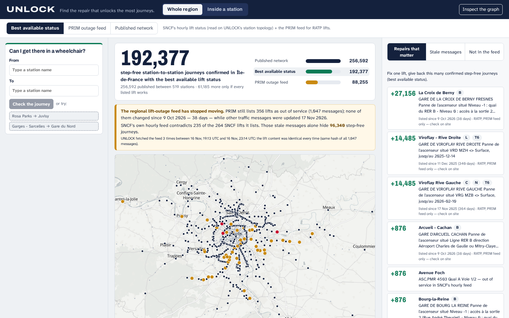
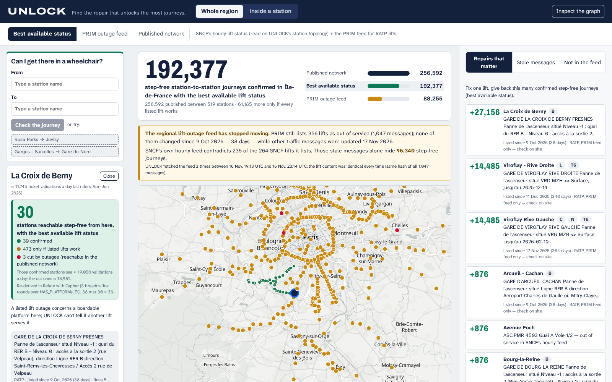
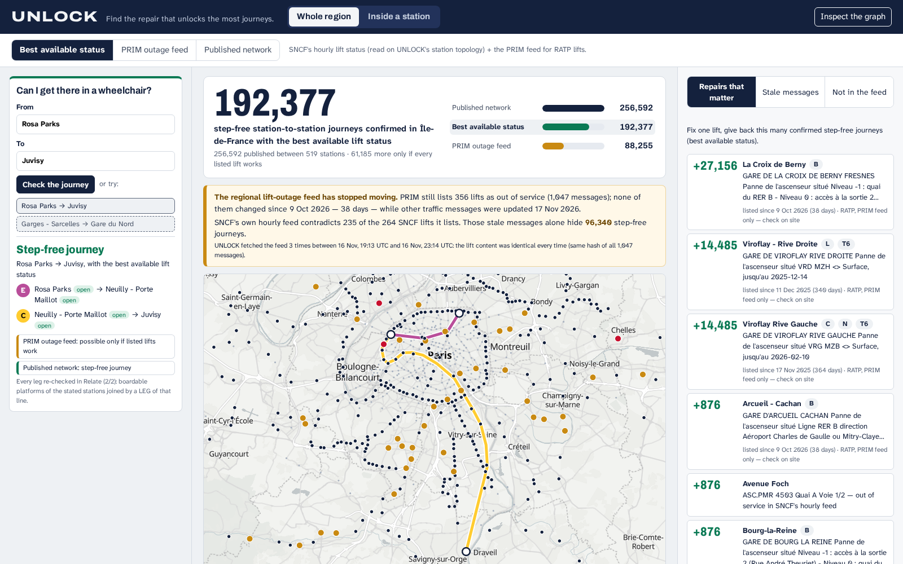

# UNLOCK — The Accessibility Impact Graph

**Find the repair that unlocks the most journeys.**

UNLOCK puts the whole Île-de-France rail, metro and tram network — 996 stations, 59 lines, every platform the
publishers declare wheelchair-boardable — into a [Relate](https://github.com/relatedb/relate) graph, together with
the lift-by-lift structure of the 401 SNCF stations and the lift outages that are actually published. It answers,
for the whole region and down to a single underpass:

* **Which step-free journeys exist right now, and which lift outages cut them?**
* **Where can I go from here in a wheelchair?** — click a station: the whole map shows what is reachable step-free.
* **Can I get from A to B in a wheelchair?** — with the route, and the outages on the way.
* **Which repair gives the most back?** — region-wide, then lift by lift inside a station.
* **Is the outage data even right?** — UNLOCK cross-checks the regional outage feed against the operator's own.

Every number on screen is computed on the graph and can be traced back to a source record.

> **What the data showed on 16 Nov 2026.** The PRIM traffic-information API lists **356 lifts out of service**
> (1,047 messages) — and **none of those messages has changed since 9 October 2026**, while every other traffic
> message is updated the same day — three fetches over four hours returned byte-identical lift content. SNCF's own hourly lift feed reports **235 of the 264 SNCF lifts it lists as
> working**. Those stale messages alone hide **96,340** step-free journeys from anyone who builds on the feed.
> Method and figures: [docs/research/NETWORK_DISCOVERY.md](docs/research/NETWORK_DISCOVERY.md).

**▶ Demo video:** v0.2.0 (station mode, 1 min 36 s): [unlock-demo.mp4](https://github.com/toskaman/unlock-accessibility-graph/releases/download/v0.2.0/unlock-demo.mp4).
The v0.3.0 region mode is shown in the screenshots below.



> Built for the *Relate by Neo4j Hackathon 2026*. This is a decision-support prototype built from public
> data. It has not been validated by any operator for operational use.

## The problem

A platform can be "accessible" and still be unreachable if one lift fails. Whether that matters depends
on what else that lift connects, whether another route exists — inside the station and across the network —
and on whether the outage is even real. That information is scattered:

- **Network and boardable platforms** are in GTFS and an IDFM accessibility table.
- **Station structure** is in a NeTEx file; **lift locations** are free text ("Voies 50 et 51 / souterrain nord").
- **Lift status** comes from two feeds that disagree: SNCF's hourly file and the PRIM traffic messages (RATP + SNCF).

UNLOCK connects these sources so you can ask: *"Which repair restores the most verified step-free journeys?"*

## Ways in

| You have… | Do this | You get |
|---|---|---|
| **A trip to make** | *Whole region* → *Can I get there in a wheelchair?* | The least-cost step-free route under each view (best available status / PRIM feed / published network), each leg re-checked in Relate, and the outages listed on the way. |
| **A region to run** | *Whole region* → *Repairs that matter* | Every listed outage and every SNCF lift out of service, ranked by the step-free journeys its repair gives back across Île-de-France. |
| **Doubts about the data** | *Whole region* → *Stale messages* / *Not in the feed* | PRIM messages SNCF contradicts, ranked by the journeys they hide; SNCF outages PRIM doesn't show. A draft note to IDFM is in `docs/research/PRIM_LIFT_FEED_NOTE.md`. |
| **An outage report** in free text (“Juvisy : ascenseur quai 50/51 HS”) | *Inside a station* → *Start from an outage report* | The exact lift in the graph with the evidence that matched, then one click to simulate its outage. Ambiguous reports are **not guessed**. |
| **A maintenance budget for a station network** | *Inside a station* → *Repairs to make* / *Lifts you can't lose* | Lifts ranked by confirmed in-station connections restored; 191 single points of failure. |
| **An AI agent** (Claude Code, Claude Desktop…) | `python -m unlock mcp` | The same graph as read-only MCP tools, including `check_journey` and `region_overview`. |

## Whole region in one minute

1. The app opens on **Whole region**. The headline is the number of ordered station pairs joined by a
   confirmed step-free journey: **256,592** in the published network, **192,377** with the best available lift
   status, **88,255** if you believe the PRIM feed.
2. The amber card explains the gap: PRIM's lift messages have not moved for 38 days, and SNCF contradicts
   235 of its 264 SNCF entries.
3. *Can I get there in a wheelchair?* — **Rosa Parks → Juvisy**: step-free with the best status (RER E then
   RER C); with the PRIM feed only *possible if listed lifts work* (11 outages listed on the route). Each leg
   says "re-checked in Relate".
4. *Repairs that matter*: **La Croix de Berny** (+27,156): with the Viroflay Rive Gauche lift also listed out
   (since Nov 2025), the T6/T10 tram stations lose their only confirmed step-free connections. These RATP
   entries come only from the frozen feed — the UI says *check on site*.
5. Click **Rosa Parks** on the map: the whole region recolours — 437 stations reachable step-free from there with the
   best available status (66 only if listed lifts work, 3 cut), together ≈ 2.8 million validations a day. With the
   PRIM feed: 294. *Re-derived in Relate with Cypher: 437 = 437.*

   

6. The station card also lists each message, its age, and — for SNCF lifts — the lift UNLOCK matched it to
   and what SNCF's hourly feed says. *Open inside the station* switches to the station cross-section.



## Inside a station


1. Open **Juvisy-sur-Orge** (RER C & D, 12 platforms joined by an underpass). The station cross-section
   shows halls and exits, underpasses and footbridges, and platforms, with each lift as a green, red or
   amber square.
2. Select lift **ASC3 (Voies 50 et 51 / souterrain nord)**. UNLOCK says 21 modeled connections can use
   it, and that all 21 would be lost if it stopped.
3. Click **Simulate outage**. Voie 50 and Voie 51 turn red, and 21 connections move from
   *Confirmed step-free* to *Blocked*. The published observations are not modified.
4. The ranking recomputes over every lift that is out of service or unknown in Île-de-France. The
   simulated lift ranks first (+21), ahead of the real out-of-service lifts at Mantes-la-Jolie (+13) and
   Noisy-le-Sec (+13).
5. Click a broken connection to see the evidence:
   - the actual Relate path (`Voie 40 –SERVES– ASC8 –SERVES– souterrain nord –SERVES– ASC3 –SERVES– Voie 50`)
   - how each edge was derived
   - each lift's published status, with snapshot id and time
   - what remains unknown
6. Switch between **Published status**, **Simulated outage** and **With proposed repair** to compare.
   Click **Restore published status**: the counts return to exactly the published-status values.

## How Relate is used (and why a graph)

| Concern | In Relate |
|---|---|
| Storage | Persistent single-file store `database/unlock.rl`, created and reopened by the app. A clean copy built from the committed snapshot is at `database/snapshot/unlock-snapshot-2026-11-16.rl`. |
| Core question | One Cypher traversal finds every acyclic route between pairs of station spaces: `MATCH p = ACYCLIC (a)-[:SERVES]-{2,10}(b)`. Lifts in series and in parallel fall out of the path set. |
| Evidence | Explanations re-read the exact path (`nodes(p)`, `relationships(p)`) and follow `HAS_STATUS → StatusSnapshot → REPORTED_IN → Dataset(sha256)` and `ABOUT ← AccessibilityAssertion → SUPPORTED_BY`. |
| Cross-check | Every analysis re-counts the affected stations entirely in Cypher, with the scenario overrides passed as a map parameter (`coalesce($ovr[l.id], …)`). The UI shows "engine = Cypher". |
| Scenarios | `(:Scenario)-[:OVERRIDES {state}]->(:Lift)` and `(:Scenario)-[:PRODUCES]->(:AnalysisResult)`. Observations are never modified. |
| Integrity | Uniqueness constraints on every id, idempotent `MERGE` import, transactions, parameterised queries. |
| Limits respected | A file store allows one writer and connections stick to one thread. UNLOCK owns the connection on a single dedicated thread and serialises all queries through it (see `backend/unlock/db.py`). |

| Region network | `(:NStation)-[:HAS_PLATFORM]->(:NPlatform {boardable})-[:LEG {line, hops}]->(:NPlatform)`, `NEXT` stop sequences per GTFS pattern, `(:NStation)-[:IS_ZONE]->(:TransferZone)<-[:IN_TRANSFER_ZONE]-(:Station)` joining the region to the station layer. |
| Outage feed | Immutable `(:OutageFeed)-[:LISTS]->(:LiftOutage)`, `-[:AFFECTS {derivation}]->(:NPlatform)`, `-[:MATCHES_LIFT]->(:Lift)` written by the resolver. |
| Region cross-check | Every reach is re-derived in Cypher by breadth-first rounds over `HAS_PLATFORM`/`LEG`; `scripts/region_crosscheck.py` does all 519 origins × 3 views — all ordered pairs agree with the engine ([region_crosscheck.json](docs/research/region_crosscheck.json)). |
| Region verification | Every journey leg is re-matched in Cypher (`(s1)-[:HAS_PLATFORM]->(x {boardable:true})-[:LEG {line}]->(y)<-[:HAS_PLATFORM]-(s2)`); leg geometry is read back from the `NEXT` chain. |

**Inspect the graph** (top right of the app) shows node and relationship counts, source hashes, the
route query and the last Cypher statements Relate actually executed, with timings.

*Why not a spreadsheet?* A list of lifts with OK/KO tells you a lift is broken, not what it breaks.
Juvisy's Voie 40 ↔ Voie 50 connection needs **two** lifts in series, and other pairs have alternative
routes. Only a path query over the connected structure gives the right answer. The ranking also flags
lifts that pay off only when repaired together.

## What the engine calculates

**Region.** A *journey* is an ordered pair of stations joined by a step-free route: board and alight only at
boardable platforms, change lines only between two boardable platforms of the same station. Platforms are
OPEN, DOUBT (a listed outage concerns it and nothing tells whether another lift serves it) or CLOSED (UNLOCK's
station topology shows no platform keeps a confirmed route to the street). *Confirmed* journeys use OPEN
platforms only; *possible* ones may use DOUBT. Reachability of all ~270,000 ordered pairs is exact (strongly
connected components + bitsets, ~10 ms), so every candidate repair is evaluated by recomputing it.

**Inside a station.** The metric is **confirmed step-free origin–destination pairs**: platform ↔ platform and
platform ↔ exit inside a station. These are modeled connections, **not people**.

Each pair is classified as one of:

- `CONFIRMED_ACCESSIBLE`
- `CONFIRMED_BLOCKED`
- `UNVERIFIED`
- `OUT_OF_SCOPE`

Two dimensions stay separate: the platform's physical step-free assessment, and each lift's
operational status. *Unknown* is never treated as working.

A repair's gain is `confirmed(S + lift fixed) − confirmed(S)` over the same pairs and snapshot. There is
also an exact best set of *k* repairs (`/api/baseline/plan?budget=k`).

Full rules are in **[docs/METHODOLOGY.md](docs/METHODOLOGY.md)**.

## Data

All sources are listed in [DATA_SOURCES.md](DATA_SOURCES.md), with what was checked about them in
[docs/research/DATA_FEASIBILITY.md](docs/research/DATA_FEASIBILITY.md).

| Source | Publisher | Licence | Used for |
|---|---|---|---|
| Accessibilité des gares (NeTEx) | SNCF Gares & Connexions | ODbL 1.0 | stations, platforms, step-free assessments, lifts, lift location text |
| État de fonctionnement des équipements d'élévatique | SNCF Gares & Connexions | ODbL 1.0 | latest published lift status (OK / KO / INCONNU, refreshed hourly) |
| Référentiel des arrêts : Zones de correspondance | Île-de-France Mobilités | Licence Ouverte 2.0 | transfer-zone anchoring |
| GTFS IDFM | Île-de-France Mobilités | Licence Mobilités | rail / metro / tram lines, platforms, `wheelchair_boarding`, stopping patterns |
| Validations sur le réseau ferré (Q2 2026) | Île-de-France Mobilités | Licence Ouverte 2.0 | average daily validations per station — a weight, shown as context |
| Accessibilité en gare | Île-de-France Mobilités | Licence Ouverte 2.0 | rail station accessibility level (autonomous / on request / booked AssistenGare / not accessible) |
| Messages Info Trafic (PRIM API, tag « Ascenseur ») | Île-de-France Mobilités | Licence Mobilités | lift outages for RATP and SNCF stations — **needs a free personal PRIM token** to refresh; a snapshot is committed |

**Important findings from the data check:**

- RATP lifts come only from the PRIM traffic messages (frozen since 9 Oct 2026); the IDFM `etat-des-ascenseurs`
  dataset needs a separate Opendatasoft key that UNLOCK does not have.
- The IDFM GTFS has no elevator pathways, so lift-to-platform links come from the publisher's location
  text. Every such edge is labelled with how it was derived.
- 705 of the 1,497 pairs (47%) have a modeled lift route. The rest are reported as *No modeled route*,
  not as inaccessible.

The derived dataset (`data/normalized/graph_input.json` and the snapshot store) is published under the
ODbL. See [data/LICENSE-DATA.md](data/LICENSE-DATA.md).

## For AI agents: UNLOCK over MCP

The hackathon theme is *connected context makes agents more reliable*. UNLOCK exposes its graph to any MCP agent
through a **read-only** Relate connection (the agent can't modify anything, even through `cypher_read`):

| Tool | What the agent gets |
|---|---|
| `find_lift(report)` | Free-text report → lift id, with the graph evidence, or AMBIGUOUS + candidates |
| `simulate_outage(lift_ids)` | Connections lost/gained, examples, Cypher cross-check, ranking afterwards (nothing persisted) |
| `rank_repairs`, `plan_repairs(budget)` | Repair priorities and the exact best set of *k* repairs |
| `critical_lifts` | Single points of failure |
| `explain_connection(pair_id)` | The actual Relate path, statuses, snapshot, derivations, unknowns |
| `station_overview`, `network_summary`, `cypher_read(query)` | Context and read-only Cypher (row-capped) |
| `step_free_reach(from, view)` | Region: stations reachable step-free from one station, with Cypher re-derivation |
| `check_journey(from, to, view)` | Region: step-free verdict, legs, outages on the way, Relate re-check of every leg |
| `region_overview`, `region_repairs`, `station_outages` | Region views, feed freshness, PRIM-vs-SNCF reconciliation, repairs and feed corrections |

```bash
pip install -e ".[agent]"
claude mcp add unlock -- python -m unlock mcp   # Claude Code (uses database/unlock.rl); other MCP clients alike
```

**A real agent, with and without the graph.** Claude Code (model `claude-sonnet-5-5`) answered eight planner and
rider questions (five station-level, three region-level). With the UNLOCK MCP tools: **7/8 correct**, every number
taken from a tool (the miss gave the right count but only one of two causes). Without them: **0/8** — the model
declined to answer each time. The region round exposed two tool-output gaps that were fixed and re-run; both rounds
are published. Details and transcripts: [docs/research/AGENT_EVAL.md](docs/research/AGENT_EVAL.md).

**Why the graph matters for the agent — measured.** On 22 hand-written outage reports
(`data/eval/incidents.jsonl`, synthetic, developer-labelled), the graph-grounded resolver identifies the right
lift or correctly refuses to guess in **21/22** cases with **0** confidently wrong answers. A text search over the
same source records (lift names and descriptions, no graph) gets **9/22** and is **confidently wrong 13 times**.
Run `python scripts/eval_incidents.py`; results in `docs/research/incident_eval.json`. The resolver was tuned on
this set; there is no held-out set yet.

## Run it

You need Python ≥ 3.10. Node ≥ 20 is only needed to rebuild the UI. Tested natively on **Windows 10
(Python 3.14.4)**, on Linux with Python 3.13, and on a Linux VM with Python 3.10 — the full test suite passes
on all three. See the [Windows notes](#windows).

```bash
git clone https://github.com/toskaman/unlock-accessibility-graph.git unlock && cd unlock
python -m venv .venv && source .venv/bin/activate      # Windows: .venv\Scripts\activate
pip install -e ".[dev]"                                # installs relate-db==1.0.2, fastapi, uvicorn

python -m unlock build      # import the committed snapshots (station layer + region network + outage feed) (~5 s)
python -m unlock serve      # http://127.0.0.1:8000  (API + prebuilt UI)
```

`serve` builds the store automatically if `database/unlock.rl` is missing. The UI is served from
`frontend/dist`. To rebuild it:

```bash
cd frontend && npm ci && npm run build      # or: npm run dev (Vite on :5173, proxies /api)
```

**Refresh from the official sources** (downloads about 130 MB, mostly GTFS):

```bash
python -m unlock fetch      # data/raw + data/manifest/sources.json (sha256, timestamps)
python -m unlock build      # re-normalise and import. Idempotent; status history is kept.
```

**Refresh the lift outages** (needs a free PRIM account token; it is read from the environment and never written
to disk by UNLOCK):

```bash
export UNLOCK_PRIM_KEY_FILE=/path/outside/the/repo/prim.key   # or UNLOCK_PRIM_KEY=...
python -m unlock fetch-outages    # data/raw/prim/line_reports.json -> data/normalized/network_outages.json
python -m unlock build
```

**Inspect the store directly** with Relate's own Python API:

```python
import relate
db = relate.connect("database/snapshot/unlock-snapshot-2026-11-16.rl", read_only=True)
db.execute("""MATCH (s:Station {name: 'Juvisy-sur-Orge'})-[:HAS_LIFT]->(l:Lift)-[e:SERVES]->(sp:Space)
              RETURN l.name, e.derivation, sp.name ORDER BY l.name""").fetchall()
```

### Windows

```powershell
py -3.12 -m venv .venv; .venv\Scripts\Activate.ps1
pip install -e ".[dev]"
python -m unlock build; python -m unlock serve
```

The store is one `.rl` file. Only one process can open it for writing at a time, so stop the server
before re-importing. If the project sits on a network drive, create the virtual environment on a local
disk (e.g. `py -3 -m venv D:\venvs\unlock`): pip upgrades inside a venv on an SMB share can fail.

## Tests

```bash
pytest                              # 77 tests: unit, real-Relate integration, API, region, agent/MCP, data quality
cd frontend && npx playwright test  # 9 end-to-end tests, incl. an axe-core WCAG 2.1 AA scan (0 serious/critical) (station flow + region flow, on a copy of the store)
python scripts/benchmark.py         # writes docs/BENCHMARK.json
```

The integration tests use the real Relate engine with file-backed stores. They cover:

- persistence across reopen, idempotent import, uniqueness constraints, rollback and backup/restore
- refusal of a second writer
- parameter safety
- alternative routes, and unknown vs. unavailable lift status
- non-destructive and reversible scenarios
- deterministic analysis ids, and use of a single status snapshot

See [TEST_PLAN.md](TEST_PLAN.md).

Measured on the pilot (2-vCPU Linux container, median of 20 runs; full table in
[docs/BENCHMARK.json](docs/BENCHMARK.json)):

| Operation | Time |
|---|---|
| Fresh import (station layer + region network + outage feed + resolver matching) | 4.7 s |
| Service start, including the station route traversal and the resolver index | 4.5 s |
| Region layer start (network, outages, station topology per zone) | 0.17 s |
| Exact reachability of every ordered station pair | 10 ms |
| Three region views, first call | 105 ms |
| Rank every region repair and feed correction (107 evaluations) | 1.4 s |
| Journey check incl. Relate re-check of every leg and geometry | 39 ms |
| Reach from one station + Cypher re-derivation (5–6 BFS rounds) | ~0.4 s |
| Single-station traversal | 11 ms |
| Create, analyse and persist a scenario (incl. Cypher cross-check) | 15 ms |
| Rank every candidate repair in the region | 6 ms |
| Explain a pair with evidence | 4 ms |
| Critical-lift scan of all 304 working lifts on modeled routes | 13 ms |

## API

Main endpoints:

- `GET /api/network/summary`
- `GET /api/network/stations`
- `GET /api/network/stations/{id}?scenario_id=&candidate_lift=`
- `GET /api/network/lifts/{id}`
- `POST /api/scenarios/simulate-outage {"lift_ids": [...]}`
- `GET /api/scenarios/{id}/analysis`
- `POST /api/scenarios/{id}/rank-interventions`
- `GET /api/scenarios/{id}/plan?budget=2`
- `GET /api/pairs/explain?pair_id=&scenario_id=&candidate_lift=`
- `POST /api/scenarios/{id}/export`
- `DELETE /api/scenarios/{id}`
- `GET /api/debug/queries`
- `GET /api/region/overview` · `GET /api/region/map?view=best|feed|published` · `GET /api/region/rank`
- `GET /api/region/reach?from=&view=` · `GET /api/region/journey?from=&to=&view=` · `GET /api/region/stations?q=` · `GET /api/region/reconciliation`
- `GET /api/region/stations/{id}/outages` · `GET /api/region/outages/{id}`

OpenAPI docs are at `/docs`. No endpoint accepts Cypher.

## Known limitations

- Lift endpoints are derived from text. Ramps and level access are not in the source, so *Blocked*
  means "no modeled step-free route". 42% of lifts describe only one end, and those ends never connect
  to anything.
- The lift-by-lift station layer covers SNCF-managed stations only. RATP lifts enter through the PRIM
  messages, without redundancy information: a listed RATP outage makes platforms DOUBT, never CLOSED.
- The PRIM lift messages are frozen since 9 Oct 2026, and "best available" still uses them for RATP.
- Region journeys are ordered station pairs, not trips or people; RER/Transilien stations are split per line,
  not per track; changes assume step-free paths between two boardable platforms of one GTFS station.
- The status feed has no per-record timestamp. The dataset's processing time is used as the
  observation time.
- Connections are counted, not people. No ridership, cost or repair-duration data is used.

## AI and third-party disclosure

- **Development:** the code, data analysis and documentation were produced with **Claude Opus 5.5**
  (Anthropic) acting as a coding agent, directed and reviewed by the entrant.
- **Runtime:** the core application uses **no AI**. Classification, ranking, planning and explanations
  are deterministic code. An optional "UNLOCK Analyst" rephrasing runs only if `ANTHROPIC_API_KEY` is
  set, and its output is rejected if it contains any number that is not in the computed facts.
- **Relate capabilities used:** embedded Python API (`relate-db` 1.0.2), single-file persistent store,
  openCypher with GQL `ACYCLIC` quantified path patterns, uniqueness constraints and range indexes,
  explicit transactions, `point()` values, read-only opens, result summaries and timings.
- **Libraries:**
  - backend: FastAPI, Uvicorn, Pydantic
  - frontend: React, Vite, TypeScript, MapLibre GL JS, fonts Atkinson Hyperlegible Next and Archivo
    (OFL)
  - tests: pytest and Playwright
- **Demo video:** recorded from the real app with Playwright; narration synthesised with the open-weight
  Kokoro TTS model (Apache-2.0). See [video/README.md](video/README.md).
- **Basemap:** © OpenFreeMap, © OpenMapTiles, data © OpenStreetMap contributors. If the tiles are
  unavailable, the app falls back to a blank map.

## Licence

Code: Apache-2.0 ([LICENSE](LICENSE)). Derived data: ODbL 1.0 with source attribution
([data/LICENSE-DATA.md](data/LICENSE-DATA.md)).
