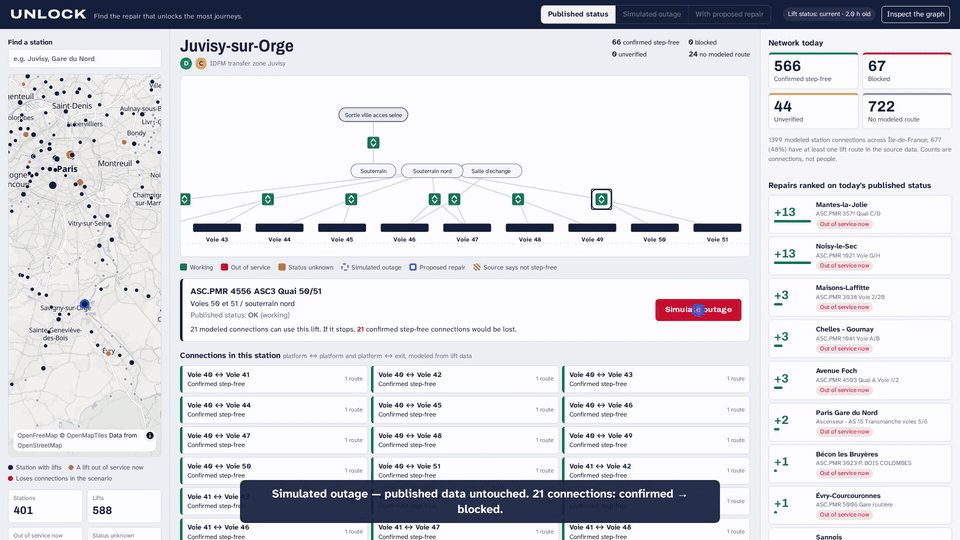

# UNLOCK — The Accessibility Impact Graph

**Find the repair that unlocks the most journeys.**

UNLOCK turns the open lift and accessibility data of the 401 SNCF stations in Île-de-France into a
connected graph in [Relate](https://github.com/relatedb/relate). You can simulate a lift outage, see
which step-free connections inside the station it breaks, and rank lift repairs across the region by how
many confirmed connections each one restores. Every number on screen can be traced through the graph
back to a source record.

**▶ Demo video (1 min 38 s, narrated):** [unlock-demo.mp4 on the v0.1.0 release](https://github.com/toskaman/unlock-accessibility-graph/releases/download/v0.1.0/unlock-demo.mp4)



> Built for the *Relate by Neo4j Hackathon 2026*. This is a decision-support prototype built from public
> data. It has not been validated by any operator for operational use.

## The problem

A platform can be "accessible" and still be unreachable if one lift fails. Whether that matters depends
on what else that lift connects, and whether another route exists. That information is scattered:

- **Station structure** is in a NeTEx file.
- **Lift locations** are free-text descriptions ("Voies 50 et 51 / souterrain nord").
- **Lift status** comes from an hourly feed.
- **Lines** are in GTFS.

UNLOCK connects these sources so you can ask: *"Which repair restores the most verified step-free
connectivity?"*

## The 30-second walkthrough

1. Open **Juvisy-sur-Orge** (RER C & D, 12 platforms joined by an underpass). The station cross-section
   shows halls and exits, underpasses and footbridges, and platforms, with each lift as a green, red or
   amber square.
2. Select lift **ASC3 (Voies 50 et 51 / souterrain nord)**. UNLOCK says 21 modeled connections can use
   it, and that all 21 would be lost if it stopped.
3. Click **Simulate outage**. Voie 50 and Voie 51 turn red, and 21 connections move from
   *Confirmed step-free* to *Blocked*. The published observations are not modified.
4. The ranking recomputes over every lift that is out of service or unknown in Île-de-France. The
   simulated lift ranks first (+21), ahead of the real out-of-service lifts at Mantes-la-Jolie (+13) and
   Noisy-le-Sec (+13).
5. Click a broken connection to see the evidence:
   - the actual Relate path (`Voie 40 –SERVES– ASC8 –SERVES– souterrain nord –SERVES– ASC3 –SERVES– Voie 50`)
   - how each edge was derived
   - each lift's published status, with snapshot id and time
   - what remains unknown
6. Switch between **Published status**, **Simulated outage** and **With proposed repair** to compare.
   Click **Restore published status**: the counts return to exactly the published-status values.

## How Relate is used (and why a graph)

| Concern | In Relate |
|---|---|
| Storage | Persistent single-file store `database/unlock.rl`, created and reopened by the app. A clean copy built from the committed snapshot is at `database/snapshot/unlock-snapshot-2026-11-16.rl`. |
| Core question | One Cypher traversal finds every acyclic route between pairs of station spaces: `MATCH p = ACYCLIC (a)-[:SERVES]-{2,10}(b)`. Lifts in series and in parallel fall out of the path set. |
| Evidence | Explanations re-read the exact path (`nodes(p)`, `relationships(p)`) and follow `HAS_STATUS → StatusSnapshot → REPORTED_IN → Dataset(sha256)` and `ABOUT ← AccessibilityAssertion → SUPPORTED_BY`. |
| Cross-check | Every analysis re-counts the affected stations entirely in Cypher, with the scenario overrides passed as a map parameter (`coalesce($ovr[l.id], …)`). The UI shows "engine = Cypher". |
| Scenarios | `(:Scenario)-[:OVERRIDES {state}]->(:Lift)` and `(:Scenario)-[:PRODUCES]->(:AnalysisResult)`. Observations are never modified. |
| Integrity | Uniqueness constraints on every id, idempotent `MERGE` import, transactions, parameterised queries. |
| Limits respected | A file store allows one writer and connections stick to one thread. UNLOCK owns the connection on a single dedicated thread and serialises all queries through it (see `backend/unlock/db.py`). |

**Inspect the graph** (top right of the app) shows node and relationship counts, source hashes, the
route query and the last Cypher statements Relate actually executed, with timings.

*Why not a spreadsheet?* A list of lifts with OK/KO tells you a lift is broken, not what it breaks.
Juvisy's Voie 40 ↔ Voie 50 connection needs **two** lifts in series, and other pairs have alternative
routes. Only a path query over the connected structure gives the right answer. The ranking also flags
lifts that pay off only when repaired together.

## What the engine calculates

The metric is **confirmed step-free origin–destination pairs**: platform ↔ platform and
platform ↔ exit inside a station. These are modeled connections, **not people**.

Each pair is classified as one of:

- `CONFIRMED_ACCESSIBLE`
- `CONFIRMED_BLOCKED`
- `UNVERIFIED`
- `OUT_OF_SCOPE`

Two dimensions stay separate: the platform's physical step-free assessment, and each lift's
operational status. *Unknown* is never treated as working.

A repair's gain is `confirmed(S + lift fixed) − confirmed(S)` over the same pairs and snapshot. There is
also an exact best set of *k* repairs (`/api/baseline/plan?budget=k`).

Full rules are in **[docs/METHODOLOGY.md](docs/METHODOLOGY.md)**.

## Data

All sources are listed in [DATA_SOURCES.md](DATA_SOURCES.md), with what was checked about them in
[docs/research/DATA_FEASIBILITY.md](docs/research/DATA_FEASIBILITY.md).

| Source | Publisher | Licence | Used for |
|---|---|---|---|
| Accessibilité des gares (NeTEx) | SNCF Gares & Connexions | ODbL 1.0 | stations, platforms, step-free assessments, lifts, lift location text |
| État de fonctionnement des équipements d'élévatique | SNCF Gares & Connexions | ODbL 1.0 | latest published lift status (OK / KO / INCONNU, refreshed hourly) |
| Référentiel des arrêts : Zones de correspondance | Île-de-France Mobilités | Licence Ouverte 2.0 | transfer-zone anchoring |
| GTFS IDFM | Île-de-France Mobilités | Licence Mobilités | rail / metro / tram lines per zone |

**Important findings from the data check:**

- The IDFM elevator dataset needs an API key, so RATP metro and RER lifts are not included yet.
- The IDFM GTFS has no elevator pathways, so lift-to-platform links come from the publisher's location
  text. Every such edge is labelled with how it was derived.
- 677 of the 1,399 pairs (48%) have a modeled lift route. The rest are reported as *No modeled route*,
  not as inaccessible.

The derived dataset (`data/normalized/graph_input.json` and the snapshot store) is published under the
ODbL. See [data/LICENSE-DATA.md](data/LICENSE-DATA.md).

## Run it

You need Python ≥ 3.10. Node ≥ 20 is only needed to rebuild the UI. Tested natively on **Windows 10
(Python 3.14.4)**, on Linux with Python 3.13, and on a Linux VM with Python 3.10 — the full test suite passes
on all three. See the [Windows notes](#windows).

```bash
git clone https://github.com/toskaman/unlock-accessibility-graph.git unlock && cd unlock
python -m venv .venv && source .venv/bin/activate      # Windows: .venv\Scripts\activate
pip install -e ".[dev]"                                # installs relate-db==1.0.2, fastapi, uvicorn

python -m unlock build      # import data/normalized/graph_input.json into database/unlock.rl (~1 s)
python -m unlock serve      # http://127.0.0.1:8000  (API + prebuilt UI)
```

`serve` builds the store automatically if `database/unlock.rl` is missing. The UI is served from
`frontend/dist`. To rebuild it:

```bash
cd frontend && npm ci && npm run build      # or: npm run dev (Vite on :5173, proxies /api)
```

**Refresh from the official sources** (downloads about 130 MB, mostly GTFS):

```bash
python -m unlock fetch      # data/raw + data/manifest/sources.json (sha256, timestamps)
python -m unlock build      # re-normalise and import. Idempotent; status history is kept.
```

**Inspect the store directly** with Relate's own Python API:

```python
import relate
db = relate.connect("database/snapshot/unlock-snapshot-2026-11-16.rl", read_only=True)
db.execute("""MATCH (s:Station {name: 'Juvisy-sur-Orge'})-[:HAS_LIFT]->(l:Lift)-[e:SERVES]->(sp:Space)
              RETURN l.name, e.derivation, sp.name ORDER BY l.name""").fetchall()
```

### Windows

```powershell
py -3.12 -m venv .venv; .venv\Scripts\Activate.ps1
pip install -e ".[dev]"
python -m unlock build; python -m unlock serve
```

The store is one `.rl` file. Only one process can open it for writing at a time, so stop the server
before re-importing. If the project sits on a network drive, create the virtual environment on a local
disk (e.g. `py -3 -m venv D:\venvs\unlock`): pip upgrades inside a venv on an SMB share can fail.

## Tests

```bash
pytest                              # 56 tests: unit, real-Relate integration, API, data quality
cd frontend && npx playwright test  # 3 end-to-end tests of the signature flow (on a copy of the store)
python scripts/benchmark.py         # writes docs/BENCHMARK.json
```

The integration tests use the real Relate engine with file-backed stores. They cover:

- persistence across reopen, idempotent import, uniqueness constraints, rollback and backup/restore
- refusal of a second writer
- parameter safety
- alternative routes, and unknown vs. unavailable lift status
- non-destructive and reversible scenarios
- deterministic analysis ids, and use of a single status snapshot

See [TEST_PLAN.md](TEST_PLAN.md).

Measured on the pilot (2-vCPU Linux container, median of 20 runs; full table in
[docs/BENCHMARK.json](docs/BENCHMARK.json)):

| Operation | Time |
|---|---|
| Fresh import | 0.9 s |
| Service start, including the region-wide route traversal | 3.7 s |
| Single-station traversal | 14 ms |
| Create and analyse a scenario | 7 ms |
| Rank every candidate repair in the region | 5 ms |
| Explain a pair with evidence | 4 ms |

## API

Main endpoints:

- `GET /api/network/summary`
- `GET /api/network/stations`
- `GET /api/network/stations/{id}?scenario_id=&candidate_lift=`
- `GET /api/network/lifts/{id}`
- `POST /api/scenarios/simulate-outage {"lift_ids": [...]}`
- `GET /api/scenarios/{id}/analysis`
- `POST /api/scenarios/{id}/rank-interventions`
- `GET /api/scenarios/{id}/plan?budget=2`
- `GET /api/pairs/explain?pair_id=&scenario_id=&candidate_lift=`
- `POST /api/scenarios/{id}/export`
- `DELETE /api/scenarios/{id}`
- `GET /api/debug/queries`

OpenAPI docs are at `/docs`. No endpoint accepts Cypher.

## Known limitations

- Lift endpoints are derived from text. Ramps and level access are not in the source, so *Blocked*
  means "no modeled step-free route". 42% of lifts describe only one end, and those ends never connect
  to anything.
- SNCF-managed stations only. RATP lifts need the IDFM key (`IDFM_API_KEY` in `.env`, not yet
  implemented as an importer).
- The status feed has no per-record timestamp. The dataset's processing time is used as the
  observation time.
- Connections are counted, not people. No ridership, cost or repair-duration data is used.

## AI and third-party disclosure

- **Development:** the code, data analysis and documentation were produced with **Claude Opus 5.5**
  (Anthropic) acting as a coding agent, directed and reviewed by the entrant.
- **Runtime:** the core application uses **no AI**. Classification, ranking, planning and explanations
  are deterministic code. An optional "UNLOCK Analyst" rephrasing runs only if `ANTHROPIC_API_KEY` is
  set, and its output is rejected if it contains any number that is not in the computed facts.
- **Relate capabilities used:** embedded Python API (`relate-db` 1.0.2), single-file persistent store,
  openCypher with GQL `ACYCLIC` quantified path patterns, uniqueness constraints and range indexes,
  explicit transactions, `point()` values, read-only opens, result summaries and timings.
- **Libraries:**
  - backend: FastAPI, Uvicorn, Pydantic
  - frontend: React, Vite, TypeScript, MapLibre GL JS, fonts Atkinson Hyperlegible Next and Archivo
    (OFL)
  - tests: pytest and Playwright
- **Demo video:** recorded from the real app with Playwright; narration synthesised with the open-weight
  Kokoro TTS model (Apache-2.0). See [video/README.md](video/README.md).
- **Basemap:** © OpenFreeMap, © OpenMapTiles, data © OpenStreetMap contributors. If the tiles are
  unavailable, the app falls back to a blank map.

## Licence

Code: Apache-2.0 ([LICENSE](LICENSE)). Derived data: ODbL 1.0 with source attribution
([data/LICENSE-DATA.md](data/LICENSE-DATA.md)).
